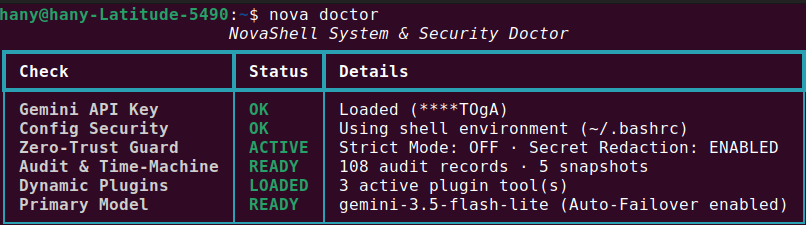

<div align="center">

# ⚡ NovaShell

**The AI terminal operator that inspects before it guesses, diffs before it writes, and lets you undo when things go sideways.**

[](https://github.com/hanyMamdouh22/novashell/releases)
[](#-installation)
[](https://www.python.org/)
[](LICENSE)

[Preview](#-in-action) · [Workflows](#-real-world-workflows) · [How It Works](#-under-the-hood) · [Security](#-security-model-and-honest-limits) · [Install](#-installation) · [Plugins](#-write-a-plugin-in-15-lines)

</div>

---

Copying shell commands back and forth from a browser chat into a live machine is slow. Giving an LLM unchecked `bash` access on your workstation or server is reckless.

**NovaShell** sits in the practical middle: read-only diagnostics run automatically so the agent sees real system state instead of hallucinating, any state-changing action stops for interactive confirmation or a live **Unified Diff**, sensitive output is scrubbed locally before leaving your machine, and every edit is saved in a **Time-Machine** rollback log.

---

## 📸 In Action

<div align="center">

**`nova doctor` — Instant check on API auth, Zero-Trust guard, audit DB, plugins & model failover**


<br />

**Live inspection with native bilingual Arabic/English RTL rendering in Linux & Windows terminals**


</div>

---

## 🛠️ Real-World Workflows

### 1. Triage a slow or misbehaving machine in seconds
Instead of chaining `free`, `df`, `ss`, and `systemctl` manually, ask in plain English or Arabic:
```bash
nova "Check why RAM is high, list listening ports, and flag any failed systemd services"
nova "افحص حالة الرام والمساحة المتاحة والخدمات الواقعة على السيرفر"
```

### 2. Edit configs without crossing your fingers
When NovaShell edits a config file, it uses `patch_file_with_sed` (Linux) or `patch_file_text` (Cross-Platform) to show a colorized **Unified Diff** first and save a pre-edit snapshot (preserving `uid/gid/chmod` for root-owned files):
```bash
nova "Disable root SSH login in /etc/ssh/sshd_config and validate syntax"
# Changed your mind or something broke?
nova history
nova undo 1
```

### 3. Audit production safely (`--plan` mode)
Need a reviewable change plan before touching a sensitive host? Plan mode hard-disables all mutating tools at the code level — it can only read and inspect:
```bash
nova --plan "Audit firewall rules and SSH hardening, then give me a risk-rated checklist"
```

### 4. One tool across Linux & Windows
NovaShell fingerprints the host at runtime and adapts automatically:
- **Ubuntu / Debian** → Bash, `apt`, `systemd`, `ufw`
- **RHEL / Rocky / Fedora** → Bash, `dnf`, `systemd`, `firewall-cmd`
- **Windows 10 / 11** → Native `PowerShell` cmdlets & Windows-aware guard rules

---

## ⚙️ Under the Hood

```text
  User Prompt (EN / AR)
          │
          ▼
 ┌─────────────────────┐     Auto-Failover      ┌──────────────────────┐
 │   NovaAgent Loop    │◄──────────────────────►│   Gemini API Models  │
 │ (Context + Memory)  │  (Retries & Ranking)   │  (v1beta · Tool Use) │
 └──────────┬──────────┘                        └──────────────────────┘
            │ tool call
            ▼
 ┌──────────────────────────────────────────────┐
 │          Zero-Trust Security Guard           │
 └──────┬──────────────────┬────────────────────┘
        │                  │                  │
   [BLOCKED]            [SAFE]            [CONFIRM]
        │                  │                  │
        ▼                  │                  ▼
  Reject & Log             │         Show Command / Live Diff
                           │         Ask User [y / N / a]
                           │                  │ approved
                           │                  ▼
                           │         Time-Machine Snapshot
                           │        (File Backup / Undo Cmd)
                           │                  │
                           ▼                  ▼
                  ┌──────────────────────────────────┐
                  │  OS Execution Layer & Plugins    │
                  │  (Bash / PowerShell / Python)    │
                  └────────────────┬─────────────────┘
                                   │ stdout / stderr
                                   ▼
                  ┌──────────────────────────────────┐
                  │   Local Secret Redaction Filter  │───► SQLite Audit Log
                  │ (Masks API keys, tokens, creds)  │     & Rollback DB
                  └────────────────┬─────────────────┘
                                   │ sanitized output
                                   ▼
                        Back to NovaAgent Loop
```

---

## 🛡️ Security Model (and Honest Limits)

Every shell command passes through a local deterministic classifier before execution:

| Tier | Behavior | Linux Examples | Windows (PowerShell) Examples |
| :--- | :--- | :--- | :--- |
| 🟢 **SAFE** | Auto-runs (read-only) | `df`, `free`, `ss`, `lsblk`, `systemctl status`, `docker ps`, `firewall-cmd --list-all` | `Get-Service`, `Get-Process`, `ipconfig`, `netstat`, `Get-Volume`, `Get-NetTCPConnection` |
| 🟡 **CONFIRM** | Prompts `[y/N/a]` | `apt install`, `systemctl restart`, `mv`, pipes/redirections, file edits | `Restart-Service`, `winget install`, config/registry changes |
| 🔴 **BLOCKED** | Hard-rejected | `rm -rf /`, `mkfs`, `dd of=/dev/sd*`, `curl \| sh`, `> /etc/shadow`, fork bombs | `Format-Volume`, `diskpart`, `Remove-Item -Recurse C:\Windows`, `reg delete HKLM`, `irm \| iex` |

**Local Secret Redaction:** Before command output goes back to the LLM, local regex rules scrub common secrets (`AIza*`, `AKIA*`, `ghp_*`, `sk-*`, Bearer tokens, private key blocks, and inline passwords). Direct access to sensitive targets like `/etc/shadow`, `/etc/sudoers`, SSH private keys, `.env`, `SAM`, and `NTDS.dit` is restricted.

> **Reality Check:** Security guardrails are a seatbelt, not invincibility. Once you approve a `CONFIRM` command (or press `a` to auto-approve a task), commands execute with your current shell's permissions. Always read the command and diff before approving — especially on production hosts.

---

## 📦 Installation

### Ubuntu / Debian (Recommended — `.deb` Package)
Installs into an isolated `/opt/novashell/.venv`, registers `/usr/local/bin/nova`, bundles built-in plugins, and adds `man nova`:
```bash
wget https://github.com/hanyMamdouh22/novashell/releases/download/v1.4.0/novashell_1.4.0_all.deb
sudo apt install -y ./novashell_1.4.0_all.deb
nova setup
```

### RHEL / Rocky Linux / Fedora
```bash
git clone https://github.com/hanyMamdouh22/novashell.git
cd novashell
bash install.sh
nova setup
```

### Windows 10 / 11
1. Install **Python 3.10+** with **"Add Python to PATH"** checked.
2. Clone or download this repo and double-click **`install_windows.bat`**.
3. Open **Windows Terminal / PowerShell** and run:
```powershell
nova setup
nova doctor
```

---

## 📖 CLI Cheat Sheet

| Command | What it does |
| :--- | :--- |
| `nova setup` | Save your Gemini API key securely |
| `nova doctor` | Check API auth, guard status, plugins, DB, and active model |
| `nova "<prompt>"` | Run a one-shot task in English or Arabic |
| `nova` | Start an interactive multi-turn terminal session |
| `nova --plan "<prompt>"` | Strict read-only inspection + numbered execution plan |
| `nova history` | View Time-Machine file & command snapshots |
| `nova undo [id]` | Revert the latest (or specific) snapshot with diff preview |
| `nova audit [N]` | Show the last `N` executed/blocked commands from SQLite |
| `nova plugins` | List loaded built-in and custom plugins |
| `nova reset` | Wipe saved conversation memory |

---

## 🔌 Write a Plugin in 15 Lines

NovaShell ships with `ops_doctor`, `service_doctor`, and `net_security`, and automatically loads any `.py` file dropped into `~/.novashell/plugins/`.

Create `~/.novashell/plugins/disk_guard.py`:
```python
import shutil

def check_disk_threshold(path: str = "/", warn_percent: int = 80) -> dict:
    """Checks disk usage for a mount point and flags if it crosses the warning threshold."""
    total, used, free = shutil.disk_usage(path)
    pct = round((used / total) * 100, 1)
    return {
        "path": path,
        "used_percent": pct,
        "free_gb": round(free / (1024**3), 2),
        "alert": pct >= warn_percent,
    }
```
Run `nova plugins` — NovaShell discovers your function and docstring automatically and exposes it to the agent.

---

## ❓ FAQ & Tips

<details>
<summary><b>How do I pin a specific Gemini model?</b></summary>

Set `NOVA_MODEL` in your environment — NovaShell will try it first and fall back to discovered models if it hits rate limits or transient `5xx` errors:
```bash
export NOVA_MODEL="gemini-3.5-flash-lite"
```
</details>

<details>
<summary><b>How does <code>nova undo</code> handle root-owned config files?</b></summary>

When patching system files (like `/etc/ssh/sshd_config`), NovaShell captures the original file along with its `uid`, `gid`, and `chmod` permissions in SQLite. Running `nova undo <id>` shows the reverse diff and restores both content and ownership/mode cleanly.
</details>

<details>
<summary><b>Arabic output looks misaligned on Windows?</b></summary>

Use **Windows Terminal** instead of the legacy `cmd.exe` window — legacy CMD lacks proper Unicode BiDi and UTF-8 Arabic shaping.
</details>

<details>
<summary><b>How do I build the <code>.deb</code> package from source?</b></summary>

```bash
./build_deb.sh
sudo apt install --reinstall -y ./novashell_1.4.0_all.deb
```
</details>

---

## 🗺️ What's Next

- [ ] **Local / Air-Gapped LLMs:** Native Ollama & OpenAI-compatible local endpoint support for offline networks
- [ ] **Remote Host Mode:** Run diagnostics and plans over SSH (`nova --host user@server`)
- [ ] **Incident Reports:** Export Markdown post-mortems directly from the audit trail (`nova report`)
- [ ] **Native `.rpm` Packaging:** First-class packaging for RHEL / Rocky fleets

---

## 👤 Author & License

Built by **Hany Mamdouh** — *Cybersecurity Engineer, Systems Administrator & AI Security Researcher*

[](https://github.com/hanyMamdouh22)
[](https://www.linkedin.com/in/hany-mamdouh-3251872b7)

Released under the [MIT License](LICENSE).
