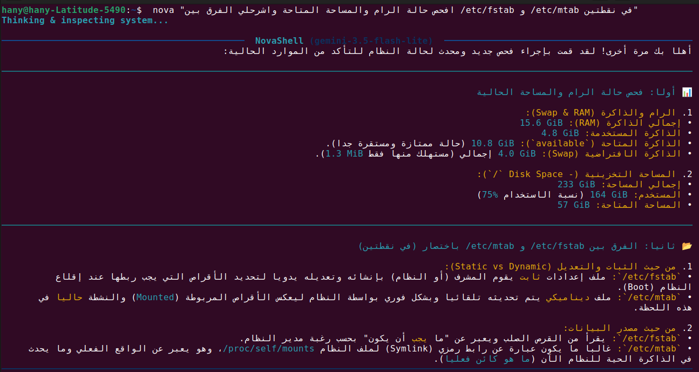
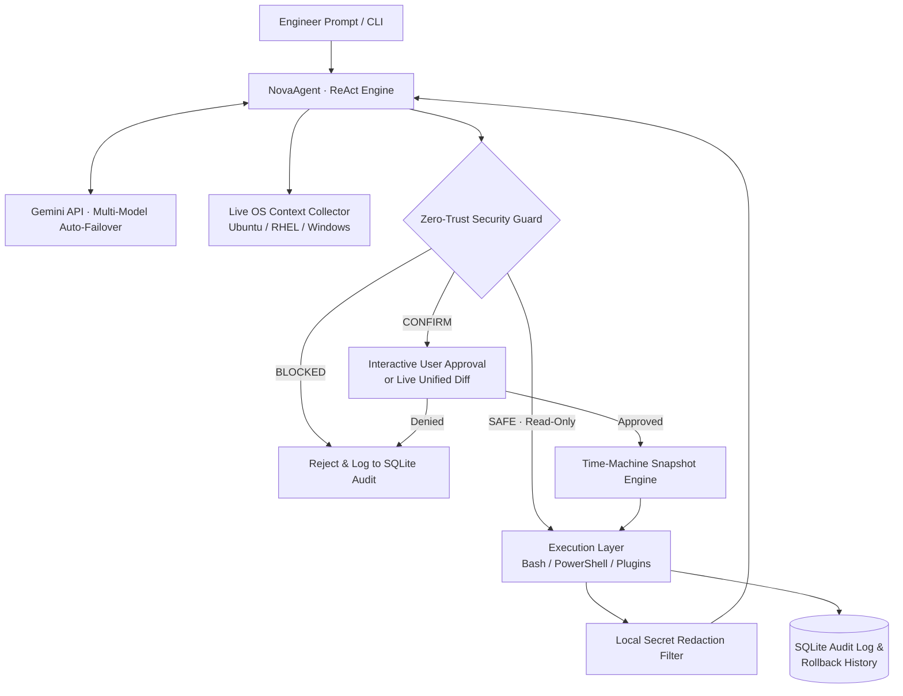

<div align="center">

# ⚡ NovaShell

**Enterprise Cross-Platform AI Systems Operator for Linux & Windows**

[](https://github.com/hanyMamdouh22/novashell/releases)
[](LICENSE)
[](https://www.python.org/)
[](#installation)
[](#zero-trust-security-model)

*Inspect live infrastructure, diagnose failures, preview unified diffs, enforce Zero-Trust guardrails, and roll back any change with one command — straight from your terminal.*

[Demo](#-live-preview) • [Features](#-key-features) • [Architecture](#-architecture) • [Security Model](#-zero-trust-security-model) • [Installation](#-installation) • [Usage](#-cli-reference) • [Plugins](#-dynamic-plugin-system) • [Roadmap](#-roadmap)

</div>

---

## 📸 Live Preview

<div align="center">

### System, Security Guard & Model Diagnostics (`nova doctor`)


<br />

### Native Bilingual RTL Terminal Output & Live System Inspection


</div>

---

## 🎯 Why NovaShell?

Most terminal AI wrappers blindly generate shell snippets or execute destructive commands without guardrails. **NovaShell** is engineered as a **defensive-first autonomous systems operator**:

- It **never guesses** system state — it inspects live OS telemetry, services, configs, and logs first.
- It **never edits blindly** — every configuration patch shows a colorized **Unified Diff** and creates a **Time-Machine Snapshot** before touching disk.
- It **never leaks secrets** — API keys, Bearer tokens, private keys, and credentials are scrubbed locally before any tool output reaches the LLM.
- It **works natively everywhere** — adapting seamlessly between **Ubuntu/Debian (`apt`, `systemd`, `ufw`)**, **RHEL/Rocky (`dnf`, `firewall-cmd`)**, and **Windows (`PowerShell`)**.

---

## ✨ Key Features

| Capability | Description |
| :--- | :--- |
| 🛡️ **Zero-Trust Security Guard** | Deterministic 3-tier command firewall (`SAFE`, `CONFIRM`, `BLOCKED`) protecting both Linux and Windows hosts against destructive operations and piped RCE. |
| 🕵️ **Secret Redaction Engine** | Local regex scrubbing of private keys, cloud tokens (`AIza`, `AKIA`, `ghp_`, `sk-`), passwords, and Bearer tokens prior to model transmission. |
| ⏪ **Time-Machine Rollback** | Automatic pre-change file backups (preserving root `uid/gid/chmod` metadata) and reverse-command tracking via `nova history` & `nova undo <id>`. |
| 🔍 **Live Unified Diff Patching** | Surgical file updates via `patch_file_with_sed` (Linux) and `patch_file_text` (Cross-Platform) with interactive approval before writing. |
| 📋 **Strict Plan Mode (`--plan`)** | Enforced read-only inspection mode that audits live state and generates a risk-rated execution plan without mutating the host. |
| 🔄 **Multi-Model Auto-Failover** | Automatic Gemini model discovery, stability ranking, exponential backoff retries, and state-preserving failover across transient API errors. |
| 🔌 **Dynamic Plugin Architecture** | Drop-in Python diagnostics (`net_security`, `ops_doctor`, `service_doctor`) plus custom user plugins auto-loaded at runtime. |
| 🌍 **Native Bilingual RTL/BiDi UI** | Clean mixed Arabic/English terminal rendering with native VTE RTL alignment, Unicode BiDi isolation, and word-boundary wrapping. |

---

## 🏗️ Architecture



---

## 🛡️ Zero-Trust Security Model

Every shell command is parsed and evaluated locally before execution:

| Tier | Policy | Linux Examples | Windows (PowerShell) Examples |
| :--- | :--- | :--- | :--- |
| 🟢 **SAFE** | Auto-executed (verified read-only) | `df`, `free`, `ss`, `lsblk`, `systemctl status`, `docker ps`, `firewall-cmd --list-all` | `Get-Service`, `Get-Process`, `ipconfig`, `netstat`, `Get-Volume`, `Get-NetTCPConnection` |
| 🟡 **CONFIRM** | Requires explicit approval (`y/N/a`) | `sudo apt install`, `systemctl restart`, file patches, pipes/redirections | `Restart-Service`, `winget install`, registry/config edits, elevated tasks |
| 🔴 **BLOCKED** | Hard-blocked unconditionally | `rm -rf /`, `mkfs`, `dd of=/dev/sd*`, `curl ... \| sh`, `> /etc/shadow`, fork bombs | `Format-Volume`, `diskpart`, `Remove-Item -Recurse C:\Windows`, `reg delete HKLM`, `irm \| iex` |

> **Sensitive File Protection:** Direct reads/writes to `/etc/shadow`, `/etc/gshadow`, `/etc/sudoers`, SSH private keys, `.env` files, `System32\config\SAM`, and `NTDS.dit` are restricted by policy.

---

## 📦 Installation

### Ubuntu / Debian (Recommended — Official `.deb` Package)

Installs NovaShell in an isolated virtual environment under `/opt/novashell/.venv`, registers the global `nova` binary, bundles default plugins, and installs `man nova`:

```bash
wget https://github.com/hanyMamdouh22/novashell/releases/download/v1.4.0/novashell_1.4.0_all.deb
sudo apt install -y ./novashell_1.4.0_all.deb
nova setup
```

### Red Hat / RHEL / Rocky Linux / Fedora

```bash
git clone https://github.com/hanyMamdouh22/novashell.git
cd novashell
bash install.sh
nova setup
```

### Windows 10 / 11 (PowerShell / Windows Terminal)

1. Ensure **Python 3.10+** is installed with **"Add Python to PATH"** checked.
2. Clone or download this repository.
3. Double-click **`install_windows.bat`** (creates an isolated `%LOCALAPPDATA%\NovaShell\.venv` and adds `nova` to your User `PATH`).
4. Reopen **Windows Terminal / PowerShell** and configure your API key:

```powershell
nova setup
nova doctor
```

---

## 🚀 Quick Start & Usage

### Health Check
Verify API key configuration, Zero-Trust Guard status, active plugins, audit database, and primary model readiness:
```bash
nova doctor
```

### One-Shot Diagnostics (English or Arabic)
```bash
nova "Check disk space, memory usage, and any failed systemd services"
nova "افحص البورتات المفتوحة وحالة الرام والخدمات الواقعة على السيرفر"
```

### Strict Read-Only Plan Mode
Safely inspect production hosts and generate an auditable change plan without executing mutating actions:
```bash
nova --plan "Audit SSH configuration and recommend hardening steps"
```

### Interactive Multi-Turn Session
```bash
nova
```

### Time-Machine Rollback
Review snapshots and revert any file patch or reversible command with a live diff preview:
```bash
nova history
nova undo 3
```

---

## 📖 CLI Reference

| Command | Description |
| :--- | :--- |
| `nova setup` | Interactively configure your Gemini API key |
| `nova doctor` | Run full system, security guard, plugin, and model diagnostics |
| `nova "<prompt>"` | Execute a one-shot natural language systems task |
| `nova` | Launch an interactive multi-turn terminal session |
| `nova --plan "<prompt>"` | Strict read-only inspection and risk-rated execution plan |
| `nova history` | List all Time-Machine file and command snapshots |
| `nova undo [id]` | Roll back the latest or specified snapshot ID |
| `nova audit [N]` | Inspect the last `N` entries in the SQLite security audit log |
| `nova plugins` | List loaded built-in and custom plugins |
| `nova reset` | Clear persisted conversational session memory |
| `man nova` | Open the built-in Linux manual page (`.deb` installs) |

---

## 🔌 Dynamic Plugin System

NovaShell dynamically loads Python tools from `~/.novashell/plugins/` alongside its built-in enterprise plugins:

- **`ops_doctor.py`** — System resource & health diagnostics.
- **`service_doctor.py`** — Service failure triage and status inspection.
- **`net_security.py`** — Open port and network exposure analysis.

To add a custom plugin, drop a `.py` file into `~/.novashell/plugins/` exporting standard typed Python functions with docstrings — NovaShell automatically registers them as agent tools on the next run.

---

## 🗂️ Project Structure

```text
novashell/
├── novashell/
│   ├── agent.py          # ReAct agent loop, session memory & multi-model failover
│   ├── cli.py            # CLI router, setup wizard, doctor, audit & history commands
│   ├── config.py         # Environment, API key & local SQLite path management
│   ├── context.py        # Dynamic Linux/Windows OS telemetry collector
│   ├── guard.py          # Zero-Trust command firewall & secret redaction engine
│   ├── plugins.py        # Dynamic plugin loader & registry
│   ├── rollback.py       # Time-Machine snapshot & undo engine
│   ├── tools.py          # Cross-platform shell runner & unified diff patchers
│   └── ui.py             # Rich terminal renderer with native VTE RTL/BiDi support
├── docs/
│   ├── doctor.png        # Health & security guard screenshot
│   └── demo.png          # Live bilingual RTL / diff showcase
├── build_deb.sh          # Debian/Ubuntu .deb package builder (with man page & venv)
├── install.sh            # Linux installer (Ubuntu / RHEL / Rocky / Fedora)
├── install_windows.bat   # One-click Windows PowerShell installer
├── LICENSE               # MIT License
└── README.md
```

---

## 🛠️ Building the `.deb` Package from Source

```bash
./build_deb.sh
sudo apt install --reinstall -y ./novashell_1.4.0_all.deb
```

---

## 🗺️ Roadmap

- [x] Cross-platform execution (Ubuntu/Debian, RHEL/Rocky, Windows PowerShell)
- [x] Zero-Trust command guard & local secret redaction
- [x] Live unified diff preview & Time-Machine rollback engine
- [x] Official `.deb` packaging with isolated `.venv` & `man nova`
- [x] Native bilingual Arabic/English RTL terminal rendering
- [ ] **v1.5:** Offline / Air-Gapped Local LLM backend (`Ollama` & OpenAI-compatible endpoints)
- [ ] **v1.5:** Remote server management over SSH (`nova --host user@server`)
- [ ] **v1.5:** Role-based security profiles (`helpdesk` read-only vs `sysadmin`) & incident report generator (`nova report`)
- [ ] **v1.5:** Native `.rpm` package builder for RHEL/Rocky fleets

---

## 👤 Author

**Hany Mamdouh** — *Cybersecurity Engineer, Systems Administrator & AI Security Researcher*

[](https://github.com/hanyMamdouh22)
[](https://www.linkedin.com/in/hany-mamdouh-3251872b7)

---

## 📄 License

Distributed under the **MIT License**. See [`LICENSE`](LICENSE) for more information.
